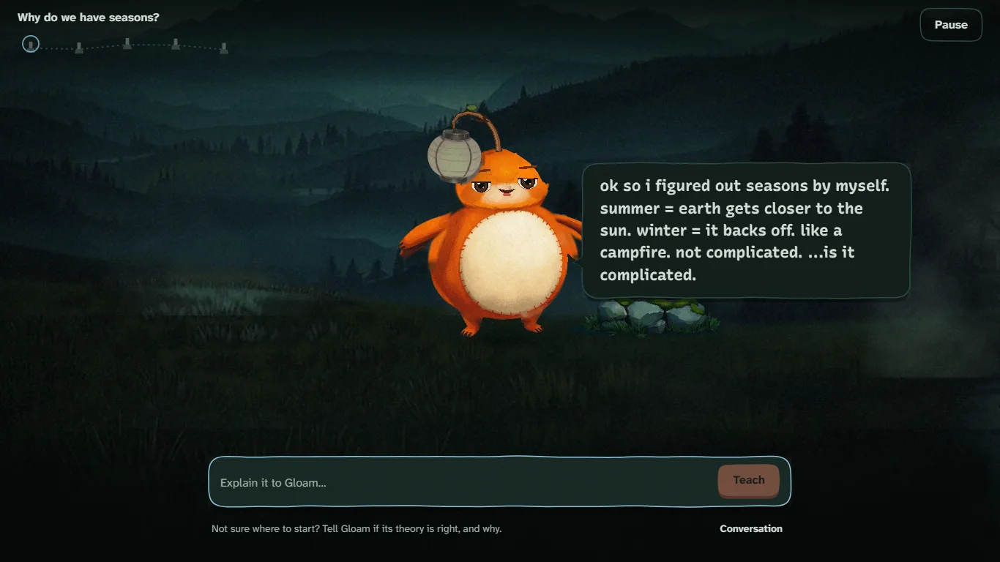

# Protégé

**The student is the teacher.** Gloam is a small, dramatic creature with a lantern on its head, and it's
confused about the lesson. Students explain things in their own words. When Gloam understands an idea, a
candle lights up, and when it gets everything, the whole valley glows.

- **Free and open source** (AGPL-3.0). No paid services, ever.
- **Runs on one school computer**, including its AI. Students join from their Chromebooks.
- **Private by design:** nicknames, not names. Nothing leaves the school's computer.
- **For every grade, K–12**, in English and French, with ways to play for every student.

**[Download Protégé](https://github.com/protege-edu/protege/releases/latest)** for Windows or Mac, or read
the [setup guide on the website](https://protege-edu.pages.dev/guide).



---

## For teachers: get it running

1. **Download** Protégé from [the website](https://protege-edu.pages.dev): `Protege-Setup.exe` for Windows,
   `Protege.dmg` for Mac. It installs for you only, with no admin rights needed.
   - Windows may say it "protected your PC": choose **More info**, then **Run anyway**.
   - On a Mac, drag Protégé into Applications. The first time, open it from **System Settings → Privacy &
     Security → Open Anyway**. (Protégé is free, so it isn't paid-signed by Microsoft or Apple.)
2. **Gloam wakes up.** Protégé opens in your browser and sets itself up: it installs
   [Ollama](https://ollama.com) (free; it runs Gloam's AI) and downloads Gloam's brain (a few GB, once). Make
   your teacher account while it downloads, and **save your recovery code**.
3. **Make a class** and give it lessons: upload your notes (one topic or a whole unit, any length: long notes
   become several lessons, drafted one at a time) or use the built-in one. Approve each lesson, add it to the
   class, and press **Show the code**. Students go to **protege-edu.pages.dev/j** (the same link every class) and
   type the code on the screen: it holds the laptop's address on the school network and sends them there.
4. **Other teachers at your school:** at the bottom of your teacher page, press **Make an invite code** and give
   it to them. They choose **Make an account** and type it in. Each code works once, for a week, and their
   classes stay separate from yours.

Every class after that: open **Protégé** from the desktop or Start menu. To stop it, close its window (or press
**Stop Protégé** on the teacher page's **Ready for class?**).

In the Start menu's Protégé folder:
- **Set up Gloam's voices** lets students talk instead of typing, and gives read-aloud Gloam's natural voice
  (the first run asks too).
- **Protégé online** lets students join from outside the school network (see
  [Putting Protégé online](#putting-protégé-online)).
- **Restore a backup** goes back to an earlier day.

**Updating:** download the new installer and run it. Your classes and students stay. **For school IT:**
`Protege-Setup.exe /VERYSILENT` installs without questions, and the portable zips (`Protege-windows.zip`,
`Protege-mac.zip`, on the [releases page](../../releases/latest)) need no installer at all. `PROTEGE_SETUP=off` in `protege.env` stops Protégé
from installing or downloading anything when it starts (for IT that manages Ollama itself).

Everything stays in your user folder (`%LOCALAPPDATA%\Protege` on Windows). Updating Protégé never touches it.
**Ready for class?** on the teacher page checks everything works.

**Is your school board asking questions?** Send them the [school board pack](docs/board/README.md).

---

## For school boards

The [school board pack](docs/board/README.md) has:
- a data inventory
- a pre-filled privacy impact assessment
- a notice to families (EN/FR) for Ontario's O. Reg. 52/26
- an AI transparency and impact assessment
- a security summary
- a guide to running Protégé on board-managed computers
- a breach plan
- an accessibility conformance report

It's written for Ontario (MFIPPA, the Education Act, EDSTA, AODA) and organized to carry over to other
provinces and countries. The board sets how long data is kept with one setting.

## Every student can play

Every student screen has **Ways to play** ("How I play" for the youngest):
- **Talk instead of typing:** private voice typing; the voice is turned into words on the school's computer and never saved.
- **Read aloud:** Gloam's words, the join steps and the recap, in Gloam's natural voice (Kokoro, made on the school's computer), or the device's own voices when that isn't set up.
- **Bigger text**, **stronger contrast**, **easier reading** (more space, or the OpenDyslexic font), and
  **less motion**.

The settings follow the student to any Chromebook. Teachers can switch them on as an accommodation, and
never see what a student picked for themselves. Every screen works with a keyboard alone and with screen
readers. See [accessibility](docs/board/accessibility.md).

## Privacy, in plain words

- **Students:** a nickname, a scrambled picture key, what they write to Gloam, and Gloam's estimate of each
  idea (not a mark: teachers can correct it). No real names, emails, birthdays or photos.
- **Where it lives:** everything stays on the computer running Protégé: the database, the AI, voice typing, read-aloud.
  No analytics, trackers, ads or third-party scripts. A strict content-security policy enforces it.
- **What students are told:** that Gloam is an AI, who reads what they write, and how to ask to see or delete
  it, in words for their age.
- **Retention:** the board's rule (by default, a class goes a year after it was last used). Practice mode
  goes after 30 days. Backups keep 7 days.
- **Teachers can:**
  - download everything about one student (for a request to see it)
  - correct it
  - delete it
- **An access log** records who viewed or changed a student's information.

Details: [data inventory](docs/board/data-inventory.md).

---

## Putting Protégé online

On a school network where devices can reach each other, students use the address (or website code) Protégé
shows. Many school Wi-Fi networks keep devices apart, though; then start with **Start Protégé online**
(`npm run class -- --tunnel` from the code):
- It opens a **Cloudflare quick tunnel** (free, no account): the laptop and the students both connect out to
  the internet, so it works on any network. Protégé downloads `cloudflared` once into its data folder, checked
  against the checksum GitHub publishes (`scripts/lib/tunnel.ts`), unless it's already installed.
- The laptop keeps a **room** on Protégé's website (`functions/api/room`, `site/room.ts`): students go to
  `protege-edu.pages.dev/j` and type the code on the projector (like `GLOW-42-K7Q2`), or click the link from
  **Copy link for students**, which stays the same every class. A room holds only the tunnel's address, and is
  forgotten after 90 days unused. If the website can't be reached, the projector shows the tunnel's own address.
- Cloudflare's servers can see what passes through a quick tunnel: fine for trying Protégé out; for real
  classes, the school should agree, or let student devices reach the laptop on its network.

A school with its own fixed tunnel (e.g. Tailscale Funnel) puts its address in `protege.env` as `PUBLIC_URL`,
and **Start Protégé online** uses that instead.

## Google sign-in (optional)

"Continue with Google" appears once `GOOGLE_CLIENT_ID` and `GOOGLE_CLIENT_SECRET` are set (in `protege.env`,
or `.env.local` from the code). Making them takes about 10 minutes and is free:

1. Get a fixed https address with Tailscale Funnel (above), and set `PUBLIC_URL`.
2. At [console.cloud.google.com](https://console.cloud.google.com), make a project called "Protégé".
3. **APIs & Services → OAuth consent screen:** pick **External**, app name "Protégé", and scopes `openid` and
   `email` only (no Google review needed).
4. **Credentials → Create credentials → OAuth client ID:** type **Web application**. Add the redirect URI
   `https://<your address>/api/auth/google/callback`.
5. Copy the client ID and secret into the settings, and restart Protégé.

Teachers can then sign in with Google (a new teacher still needs an invite). Students only see the Google
button if their teacher switches it on for the class. Protégé asks Google for nothing but a scrambled account
number: no name, email or photo.

---

## How it works (the short version)

Every time a student sends a message:

1. **Safety check** (`lib/ai/safety.ts`).
   - Not-for-school messages get an in-character redirect, and the AI never sees them.
   - Insults get a good-natured comeback.
   - If a student says something worrying, Gloam drops the jokes and points them to a trusted adult.
   - Younger ages get a stricter filter. It knows English and French.
2. **The judge** (`lib/companion/grade.ts`).
   - Code finds which ideas the message could be about.
   - Then the AI answers one small question per idea: does this agree with the true version or the wrong one?
3. **The director** (`lib/companion/director.ts`). Plain code decides what happens in the story. If the student
   didn't explain anything ("idk", "js tell me"), Gloam answers instantly with a hand-written line.
4. **Gloam performs** (`lib/ai/prompts/gloam.ts`). The AI writes Gloam's reply to the student's exact words.
   - Gloam never sees the real answers, so it can't give them away.
   - Every reply is checked before a student sees it.

Every AI answer is checked with Zod (`lib/ai/schemas.ts`). If the AI sends back nonsense, Protégé retries,
then falls back to a friendly line. Students never see an error from the AI.

The adventure:
- Each idea is a shrine with a candle on a painted journey. Gloam walks to the next shrine when an idea
  clicks.
- At the end, the recap is written from the teacher-approved lesson, never by the AI.
- Gloam grows across lessons. Its lantern grows with everything a student has taught it.

## Age styles

| Style | Grades | Gloam is… | Its world | Its screens |
|---|---|---|---|---|
| `little` | K–2 | a round, bright fluffball; silly, gentle, tiny words | a sunny storybook meadow | cream paper, big text and buttons, read-aloud and the mic on by default, sentence starters, 2 secret pictures |
| `junior` | 3–5 | a playful buddy with a cheeky grin | a storybook forest with mushroom houses | lavender paper, bigger text, read-aloud, sentence starters |
| `middle` | 6–8 | goofy and dramatic, in a scarf | windy sea cliffs at twilight | twilight navy, game-like |
| `senior` | 9–12 | dry, deadpan, smugly wrong | a moody night valley | night paper, lantern-lit |

The class's grade picks the style. Everything for one age lives in `lib/age-styles/`:
- Gloam's personality and AI rules
- its hand-written lines
- every word on screen, in English and French
- the visuals, celebrations, safety level and input options

## Languages

English and French. A lesson's language (guessed from the teacher's notes, changeable) is what students
explain in and Gloam speaks. A class's language is for the screens around lessons. French has its own
hand-written lines for every age, and the safety filter and "just tell me" detector understand French (Québec
swears too). Another language is one more file like `lib/age-styles/fr.ts`.

---

## For developers

### Run it from the code

1. Install [Node.js](https://nodejs.org) (LTS) and [Ollama](https://ollama.com/download).
2. `ollama pull qwen3:4b-instruct` (about 2.5 GB; smaller models gave credit for wrong answers).
3. In this folder: `npm install`, then `npm run dev`. Open http://localhost:3000. The teacher setup code is
   printed in the terminal.

All AI settings are in `.env.local` (see `.env.example`): `AI_MODEL`, `AI_BASE_URL` (any OpenAI-compatible
server), `AI_CONCURRENCY` (how many AI calls at once; the rest wait in a fair line, and Gloam says so in
character). With 30 students on a laptop with an Intel Arc GPU, every message was answered with no errors, in
about 13 seconds typically.

### Commands

| Command | What it does |
|---|---|
| `npm run dev` | Runs the app at http://localhost:3000 |
| `npm run class [-- --tunnel]` | Builds and runs Protégé for a real class, with the address and a QR code |
| `npm run voice:setup` / `npm run voice` | Downloads / starts voice typing (whisper.cpp) and Gloam's read-aloud voice (Kokoro), both local |
| `npm run release` | Builds the download teachers use (`release/*.zip`) |
| `npm run test:logic` | 70 tests of the rules: grading, progress, giveaways, safety, voice, ways to play |
| `npm run test:accounts` | 45 tests of accounts, privacy and retention, on a throwaway database |
| `npm run licenses` | Checks every library's licence and writes `THIRD-PARTY-NOTICES.md` |
| `npm run restore` / `access-log` / `reset-teacher` | Jobs for whoever runs Protégé |
| `npm run load-test -- --code GLOW-42` | 30 pretend students teaching at once, with the real AI |
| `npm run eval` | Pretend students (good, wrong, rude, off-topic) talk to Gloam; prints transcripts |
| `npx tsx --conditions=react-server scripts/audit.ts` | The every-page check: every screen, age, language and size, with axe accessibility rules (see the file for setup) |
| `npx tsx scripts/keyboard.ts`, `scripts/perf.ts` | Keyboard-only walk-through; smoothness with a 4× slower CPU |
| `npm run typecheck`, `npm run lint` | TypeScript and style |

**Test mode** (development only): `/?test` lets pasted answers teach Gloam, and a panel jumps to any moment.
Development pages: `/dev/style`, `/dev/rig`, `/dev/journey`.

**Testing sign-up, joining or load:** use a copy of the database (`PROTEGE_DATA_DIR=<folder>`). The first
sign-up claims everything. Never run `next build` beside `next dev` (they share `.next`). `npm run release`
builds into `.next-release`, so it's safe.

### Releases

Raise `version` in `package.json`, then tag it (`git tag v0.2.0 && git push --tags`). GitHub Actions runs the
tests, builds the Windows and Mac downloads, and attaches them to a GitHub release. Teachers find it with
**Check for updates**, which looks at the repository named in `package.json`. A fork sets its own there (or
`PROTEGE_REPO=owner/name`). Before anything is published, GitHub tries each download for real: the Windows installer is
installed silently, started, asked a question, stopped and uninstalled; the Mac app is opened from its `.dmg`,
checked, started and stopped. If either doesn't answer, nothing is published.

### The website

https://protege-edu.pages.dev is built by `npm run site` from `site/` and `docs/board/`, and hosted for free on
Cloudflare Pages, which rebuilds it on every push to `main`. The Cloudflare project's settings:

| Setting | Value |
|---|---|
| Production branch | `main` |
| Build command | `npm run site` |
| Build output directory | `site-dist` |
| Node version | from `.node-version` |
| Web Analytics | **off** (the site has no trackers, and its privacy page says so) |

**Rooms (once, for Protégé online):** the website's `functions/` folder answers `/api/room`, and needs a small
free storage space on the same Cloudflare account. In the Cloudflare dashboard:
1. **Storage & databases → KV → Create**, named `protege-rooms`.
2. **Workers & Pages →** the website's project **→ Settings → Bindings → Add → KV namespace**: variable name
   `ROOMS`, namespace `protege-rooms`. Save, then deploy again (push any change, or **Retry deployment**).
3. Check: `https://protege-edu.pages.dev/api/room/TEST1` should answer "No such room." (Before step 2, it says
   rooms aren't set up, and Protégé online shows the tunnel's own address instead.)

The site sets strict headers (`site-dist/_headers`): nothing from other websites can load, and no cookies are
used. Any static host works too: upload `site-dist/`.

How it's made:
- `site/pages/home.ts` is the homepage's HTML (complete without JavaScript).
- `site/js/` makes it move: `stage.ts` puts the real animated Gloam (the app's rig) in the valley behind the
  page, and `home.ts` plays the chapters with GSAP's ScrollTrigger. With reduced motion, nothing is pinned
  or scrubbed.
- Every word is in `site/i18n.ts`, in English and French (French pages are in `fr/`; Gloam's lines in
  `site/js/lines.ts`, recorded in both of its voices by `scripts/site-voice.ts`).
- `site/content/` (and `site/content/fr/`) and `docs/board/` are the reading pages.
- **`npm run site:check`** is the website's quality gate. It walks every page at 8 screen shapes (including
  short, wide laptops at 150% scaling), with real scrollbars, in English and French, with motion on and off,
  stopping every 100px. It fails on sideways scrolling, words cut off or under the top bar, words on top of
  words or on Gloam, words on a picture under 4.5:1 contrast (measured from the pixels), and any console error.
  Screenshots of every failure go to `screenshots/site-check/`. Run it before every push that touches the site.
- `npx tsx scripts/site-art.ts http://localhost:3000` remakes the cut-out Gloams from the rig (`--setup` adds
  the setup page's screenshot). `scripts/installer-art.ts` does the same for the installers.

### Contributing

See [CONTRIBUTING.md](CONTRIBUTING.md). Security problems go to [SECURITY.md](SECURITY.md), never a public issue.

### Project map

```
app/                  pages and API routes (Next.js)
components/access/    Ways to play, the mic, read-aloud
components/cinema/    the painted worlds (JourneyWorld = the adventure)
components/gloam/     Gloam: the animated rig and its poses
components/game/      the game screens: title, intro, teaching, journal, menus
components/teacher/   the teacher side: lessons, review, classes, status
components/ui/        the hand-cut UI kit: buttons, paper panels, panels, the logo
lib/access/           Ways to play settings
lib/age-styles/       everything per age and language (personality, lines, words, look)
lib/ai/               ALL the AI code (swap models in config.ts)
lib/voice/            voice typing (whisper.cpp on this computer, or on-device in the browser) and
                      read-aloud in Gloam's voice (Kokoro, via scripts/speak.ts)
lib/privacy/          retention, the daily clean-up, data downloads, the access log
lib/companion/        progress rules, the director, grading, sessions
lib/db/               the local SQLite database and backups
scripts/              launcher, release, admin jobs, tests, the audit
docs/board/           the school board pack
art/                  the scripts that painted the worlds and Gloams (FLUX.1-schnell, local)
```

### The art

The worlds and Gloams were painted on a laptop with a free local image model (FLUX.1-schnell, Apache 2.0)
through ComfyUI, then finished by scripts in `art/`. For example:
- `paint.py` paints candidates
- `grade.py` makes the dark and lit versions
- `panorama.py` grows the journey
- `gloam2_rig.py` cuts a painted Gloam into an animatable rig

Any image can be replaced 1:1 by an artist. PixiJS draws it on the GPU. Cheap Chromebooks get a lighter
version.

## Troubleshooting

- **Students on the school Wi-Fi can't open the address:** the first time, Windows asks whether Node.js may
  use the network. Allow it on private networks. Some school networks block devices from reaching each
  other; ask IT, or use Tailscale Funnel.
- **"Gloam's brain isn't running":** open the Ollama app. Students press Try again; nothing is lost.
- **Forgot the setup code:** it's in `SETUP-CODE.txt` in the data folder, and printed every time Protégé
  starts until the first account exists.
- **A teacher lost their password and recovery code:** on the computer running Protégé, run
  `node\node.exe launch.js --reset-teacher their@email` in the Protégé folder (`npm run reset-teacher --
  their@email` from the code).
- **A student forgot their pictures:** the teacher opens the student and presses **Reset their pictures**.
- **The page keeps reloading (while developing):** stop `npm run dev`, delete `.next`, start again.

## Licence

Protégé is free software under the [GNU Affero General Public License v3.0](LICENSE). Anyone can use, study,
change and share it. If you run a changed version for others, you share your changes too.
[THIRD-PARTY-NOTICES.md](THIRD-PARTY-NOTICES.md) credits the libraries, fonts and models it's built on.
Security problems: see [SECURITY.md](SECURITY.md).
