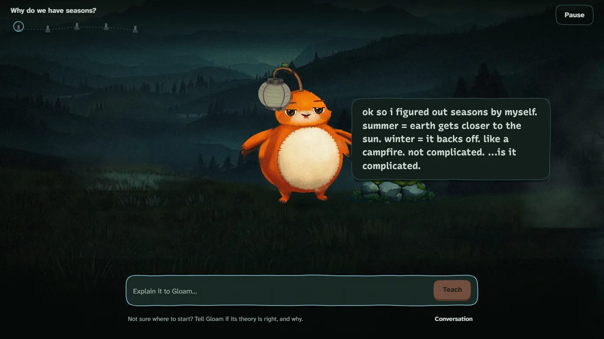

# Protégé

**The student is the teacher.** Gloam is a small, dramatic creature with a lantern on its head, and it's
confused about the lesson. Students explain things in their own words. When Gloam understands an idea, a
candle lights up, and when it gets everything, the whole valley glows.

- **Open source** (AGPL-3.0), and **nothing to install**: it runs in the browser, at school or at home.
- **Gloam's brain is Claude** (Claude Haiku 5.5, by Anthropic): about 11 cents for a class of 30 students
  sending 40 messages each. The hosting is free.
- **Private by design:** nicknames, never real names. A student's nickname is never sent to the AI.
- **For every grade, K–12**, in English and French, with ways to play for every student.

**Teachers:** [protege-edu.vercel.app/teacher](https://protege-edu.vercel.app/teacher).
**Students:** [protege-edu.pages.dev/j](https://protege-edu.pages.dev/j) and type the class code.
The [guide on the website](https://protege-edu.pages.dev/guide) explains it all.



---

## For teachers

1. **Make your account** at [protege-edu.vercel.app/teacher](https://protege-edu.vercel.app/teacher) with your
   school's **staff code**. Ask your principal, or a teacher at your school who uses Protégé. Save your
   recovery code.
2. **Make a class** and give it lessons: upload your notes (PDF, PowerPoint, Word or pasted text, one topic
   or a whole unit) or use the built-in one. Your file is read in your own browser and never uploaded. Review
   each lesson Gloam drafts, approve it, and give it to the class.
3. **Press Show the code.** Students go to **protege-edu.pages.dev/j** and type the class code (like
   GLOW-42), or scan the QR code. Or post the link from **Copy link for students** in Google Classroom once.
4. **Ask each student to tell you their nickname** the first time. Protégé never stores real names.

**Your school** (on your teacher page) shows your school's staff code and everyone who signed up with it. If
someone who isn't a teacher ever gets in, remove them there and make a new staff code: the old one stops
working at once.

**Is your school board asking questions?** Send them the [school board pack](docs/board/README.md).

## For whoever runs Protégé (the owner)

The first account made on a Protégé is its **owner**. On the **Owner page** you:
- **add each school** that uses it, and send the school its staff code (by school email, to the principal)
- see **how much of Gloam's brain was used today**, and roughly what it cost
- make a new recovery code for a teacher locked out of their account

### Daily limits

Claude is paid per use, so every day:

| Limit | Default | Setting |
|---|---|---|
| Messages per student | 300 | `AI_DAILY_PER_STUDENT` |
| Messages per class | 3,000 | `AI_DAILY_PER_CLASS` |
| Lessons drafted per teacher | 40 | `AI_DAILY_DRAFTS_PER_TEACHER` |
| Everything together (a lesson counts 50) | 20,000 (about $2) | `AI_DAILY_TOTAL` |

When one is reached, Gloam falls asleep in character until tomorrow, and nothing is sent to Claude. Also set a
**monthly spending limit** on the Claude account (Anthropic Console → Limits): then a mistake can never cost
more than you chose.

---

## For school boards

The [school board pack](docs/board/README.md) has:
- a data inventory
- a pre-filled privacy impact assessment
- a notice to families (EN/FR) for Ontario's O. Reg. 52/26
- an AI transparency and impact assessment
- a security summary
- a guide to hosting Protégé for a board
- a breach plan
- an accessibility conformance report

It's written for Ontario (MFIPPA, the Education Act, EDSTA, AODA) and organized to carry over to other
provinces and countries. The board sets how long data is kept with one setting. Protégé is open source, so a
board that needs its own hosting or its own AI agreement can run its own copy.

## Every student can play

Every student screen has **Ways to play** ("How I play" for the youngest):
- **Talk instead of typing:** voice typing, done by the student's own device. The voice is never saved or sent
  anywhere, so it only appears on devices that can do it privately (like a recent Chrome).
- **Read aloud:** Gloam's words, the join steps and the recap, with the device's own voices.
- **Bigger text**, **stronger contrast**, **easier reading** (more space, or the OpenDyslexic font), and
  **less motion**.

The settings follow the student to any Chromebook. Teachers can switch them on as an accommodation, and
never see what a student picked for themselves. Every screen works with a keyboard alone and with screen
readers. See [accessibility](docs/board/accessibility.md).

## Privacy, in plain words

- **Students:** a nickname, a scrambled picture key, what they write to Gloam, and Gloam's estimate of each
  idea (not a mark: teachers can correct it). No real names, emails, birthdays or photos.
- **Where it lives:** in Protégé's online database (Turso). The app runs on Vercel. Both are in the United
  States.
- **What goes to Claude:** the lesson, Gloam's instructions, and what the student wrote, with the last few
  messages of that conversation. Never their nickname or anything else about who they are. Anthropic doesn't
  use it to train its AI.
- **Voice** stays on the student's device. Lesson files stay on the teacher's computer.
- **No analytics, trackers, ads or third-party scripts.** A strict content-security policy enforces it.
- **What students are told:** that Gloam is an AI made with Claude, who reads what they write, and how to ask
  to see or delete it, in words for their age.
- **Retention:** the board's rule (by default, a class goes a year after it was last used). Practice mode
  goes after 30 days.
- **Teachers can** download everything about one student (for a request to see it), correct it, or delete it.
- **An access log** records who viewed or changed a student's information.

Details: [data inventory](docs/board/data-inventory.md).

---

## How it works (the short version)

Every time a student sends a message:

1. **Daily limits** (`lib/ai/allowance.ts`): if today's are used up, Gloam falls asleep in character.
2. **Safety check** (`lib/ai/safety.ts`).
   - Not-for-school messages get an in-character redirect, and the AI never sees them.
   - Insults get a good-natured comeback.
   - If a student says something worrying, Gloam drops the jokes and points them to a trusted adult.
   - Younger ages get a stricter filter. It knows English and French.
3. **The judge** (`lib/ai/prompts/judge.ts`, `lib/companion/grade.ts`).
   - Plain code catches "idk", "lol" and "just tell me" without the AI.
   - Otherwise ONE call asks Claude which of the lesson's ideas the message is about, and whether it agrees
     with the true version or the wrong one. Code decides which of its answers count.
4. **The director** (`lib/companion/director.ts`). Plain code decides what happens in the story. Many turns are
   a hand-written line, instantly.
5. **Gloam performs** (`lib/ai/prompts/gloam.ts`). Claude writes Gloam's reply to the student's exact words.
   - Gloam never sees the real answers, so it can't give them away.
   - Every reply is checked before a student sees it.

Every AI answer is structured JSON, checked with Zod (`lib/ai/schemas.ts`). If Claude can't be reached,
declines, or sends something unusable, Protégé retries or falls back to a hand-written line. Students never see
an error from the AI.

Saving tokens is built in (`lib/ai/client.ts`): the lesson part of every prompt is cached (a tenth of the
price after the first message), thinking is off for chat, and answers are short.

The adventure:
- Each idea is a shrine with a candle on a painted journey. Gloam walks to the next shrine when an idea
  clicks.
- At the end, the recap is written from the teacher-approved lesson, never by the AI.
- Gloam grows across lessons. Its lantern grows with everything a student has taught it.

## Age styles

| Style | Grades | Gloam is… | Its world | Its screens |
|---|---|---|---|---|
| `little` | K–2 | a round, bright fluffball; silly, gentle, tiny words | a sunny storybook meadow | cream paper, big text and buttons, read-aloud and the mic on by default, sentence starters, 2 secret pictures |
| `junior` | 3–5 | a playful buddy with a cheeky grin | a storybook forest with mushroom houses | lavender paper, bigger text, read-aloud, sentence starters |
| `middle` | 6–8 | goofy and dramatic, in a scarf | windy sea cliffs at twilight | twilight navy, game-like |
| `senior` | 9–12 | dry, deadpan, smugly wrong | a moody night valley | night paper, lantern-lit |

The class's grade picks the style. Everything for one age lives in `lib/age-styles/`:
- Gloam's personality and AI rules
- its hand-written lines
- every word on screen, in English and French
- the visuals, celebrations, safety level and input options

## Languages

English and French. A lesson's language (guessed from the teacher's notes, changeable) is what students
explain in and Gloam speaks. A class's language is for the screens around lessons. French has its own
hand-written lines for every age, and the safety filter and "just tell me" detector understand French (Québec
swears too). Another language is one more file like `lib/age-styles/fr.ts`.

---

## Putting your own Protégé online

Protégé is three free services and one paid one. Accounts on all of them must belong to an adult.

| What | Where | Cost |
|---|---|---|
| The app | [Vercel](https://vercel.com) (Hobby plan: free, for non-commercial use) | free |
| The database | [Turso](https://turso.tech) | free (5 GB) |
| The public website | [Cloudflare Pages](https://pages.cloudflare.com) | free |
| Gloam's brain | [Claude API](https://console.anthropic.com) | about 11 cents per class |

1. **Turso:** create a database named `protege` near your schools (e.g. AWS US East). Copy its URL
   (`libsql://…`) and make a **Read & Write** token.
2. **Claude:** in the Anthropic Console, make an API key, and set a monthly spending limit.
3. **Vercel:** **Add New → Project**, import this repository, then under **Settings → Environments →
   Production → Environment Variables** add:

   | Name | Value |
   |---|---|
   | `ANTHROPIC_API_KEY` | the Claude key |
   | `TURSO_DATABASE_URL` | the Turso URL |
   | `TURSO_AUTH_TOKEN` | the Turso token |
   | `CRON_SECRET` | any long random password (it protects the daily clean-up) |

   Deploy. `vercel.json` makes the build set up the database tables first (`npm run db:migrate`) and runs the
   daily clean-up. In **Settings → Functions**, pick the region closest to the database (Washington, D.C.,
   `iad1`, for AWS US East), then redeploy. Under **General → Data Preferences**, switch off sharing the
   project's data for AI training.
4. **Your account:** open `/teacher` on your app. It asks for a **setup code**: find it in Vercel's **Logs**
   (search for `setup code`). That first account is the owner. Then add your school on the Owner page.
5. **The website** (optional): see [The website](#the-website). Point its join page at your app with
   `PROTEGE_APP_URL`.

Never put a key or token in a file in the repository, or in a chat. If one leaks, make a new one and replace
it in Vercel.

## Google sign-in (optional)

"Continue with Google" appears once `GOOGLE_CLIENT_ID` and `GOOGLE_CLIENT_SECRET` are set in Vercel. Making
them takes about 10 minutes and is free:

1. At [console.cloud.google.com](https://console.cloud.google.com), make a project called "Protégé".
2. **APIs & Services → OAuth consent screen:** pick **External**, app name "Protégé", and scopes `openid` and
   `email` only (no Google review needed).
3. **Credentials → Create credentials → OAuth client ID:** type **Web application**. Add the redirect URI
   `https://<your app's address>/api/auth/google/callback`.
4. Copy the client ID and secret into Vercel's environment variables, and redeploy.

Teachers can then sign in with Google (a new teacher still needs their school's staff code). Students only see
the Google button if their teacher switches it on for the class. Protégé asks Google for nothing but a
scrambled account number: no name, email or photo.

---

## For developers

### Run it from the code

1. Install [Node.js](https://nodejs.org) (LTS).
2. Copy `.env.example` to `.env` and put a Claude API key in `ANTHROPIC_API_KEY`.
3. In this folder: `npm install`, then `npm run dev`. Open http://localhost:3000. The database is a file on
   your computer (`%LOCALAPPDATA%\Protege\protege.db` on Windows), and the setup code for the first account
   is printed in the terminal.

All AI code is in `lib/ai/`; the model is one setting (`AI_MODEL`, default `claude-haiku-5-5`).

### Commands

| Command | What it does |
|---|---|
| `npm run dev` | Sets up the database, then runs the app at http://localhost:3000 |
| `npm run db:migrate` | Brings the database's tables up to date (Turso when `TURSO_DATABASE_URL` is set) |
| `npm run test:logic` | Tests of the rules: grading, progress, giveaways, safety, ways to play, lesson plans |
| `npm run test:accounts` | Tests of accounts, schools, privacy and retention, on a throwaway database |
| `npm run lint:promises` | A stricter check for a missing `await` (run it after changing database code) |
| `npm run eval` | Pretend students (good, wrong, rude, off-topic) talk to Gloam; prints transcripts and the cost |
| `npm run licenses` | Checks every library's licence and writes `THIRD-PARTY-NOTICES.md` |
| `npm run access-log` / `reset-teacher` | Jobs for whoever runs Protégé (on the database `TURSO_*` points at) |
| `npm run load-test -- --code GLOW-42` | 30 pretend students teaching at once, with the real AI (costs a little) |
| `npx tsx --conditions=react-server scripts/audit.ts` | The every-page check: every screen, age, language and size, with axe accessibility rules (see the file for setup) |
| `npx tsx scripts/keyboard.ts`, `scripts/perf.ts` | Keyboard-only walk-through; smoothness with a 4× slower CPU |
| `npm run typecheck`, `npm run lint` | TypeScript and style |

**Test mode** (development only): `/?test` lets pasted answers teach Gloam, and a panel jumps to any moment.
Development pages: `/dev/style`, `/dev/rig`, `/dev/journey`.

**Testing sign-up, joining or load:** use a throwaway database (`PROTEGE_DATA_DIR=<folder>`). The first
sign-up becomes the owner. Never run `next build` beside `next dev` (they share `.next`).

### The website

https://protege-edu.pages.dev is built by `npm run site` from `site/` and `docs/board/`, and hosted for free on
Cloudflare Pages, which rebuilds it on every push to `main`. The Cloudflare project's settings:

| Setting | Value |
|---|---|
| Production branch | `main` |
| Build command | `npm run site` |
| Build output directory | `site-dist` |
| Node version | from `.node-version` |
| Web Analytics | **off** (the site has no trackers, and its privacy page says so) |

The site sets strict headers (`site-dist/_headers`): nothing from other websites can load, and no cookies are
used. Any static host works too: upload `site-dist/`. Its join page (`/j`) sends students on to the app
(`PROTEGE_APP_URL`, default `https://protege-edu.vercel.app`).

How it's made:
- `site/pages/home.ts` is the homepage's HTML (complete without JavaScript).
- `site/js/` makes it move: `stage.ts` puts the real animated Gloam (the app's rig) in the valley behind the
  page, and `home.ts` plays the chapters with GSAP's ScrollTrigger. With reduced motion, nothing is pinned
  or scrubbed.
- Every word is in `site/i18n.ts`, in English and French (French pages are in `fr/`; Gloam's lines in
  `site/js/lines.ts`, recorded in `site/audio/`).
- `site/content/` (and `site/content/fr/`) and `docs/board/` are the reading pages.
- **`npm run site:check`** is the website's quality gate. It walks every page at 8 screen shapes (including
  short, wide laptops at 150% scaling), with real scrollbars, in English and French, with motion on and off,
  stopping every 100px. It fails on sideways scrolling, words cut off or under the top bar, words on top of
  words or on Gloam, words on a picture under 4.5:1 contrast (measured from the pixels), and any console error.
  Screenshots of every failure go to `screenshots/site-check/`. Run it before every push that touches the site.
- `npx tsx scripts/site-art.ts http://localhost:3000` remakes the cut-out Gloams from the rig.

### Contributing

See [CONTRIBUTING.md](CONTRIBUTING.md). Security problems go to [SECURITY.md](SECURITY.md), never a public issue.

### Project map

```
app/                  pages and API routes (Next.js)
components/access/    Ways to play, the mic, read-aloud
components/cinema/    the painted worlds (JourneyWorld = the adventure)
components/gloam/     Gloam: the animated rig and its poses
components/game/      the game screens: title, intro, teaching, journal, menus
components/teacher/   the teacher side: lessons, review, classes, your school, the owner page
components/ui/        the hand-cut UI kit: buttons, paper panels, panels, the logo
lib/access/           Ways to play settings
lib/age-styles/       everything per age and language (personality, lines, words, look)
lib/ai/               ALL the AI code (the model is one setting in config.ts), and the daily limits
lib/voice/            voice typing, on the student's device only
lib/privacy/          retention, the daily clean-up, data downloads, the access log
lib/companion/        progress rules, the director, grading, sessions
lib/db/               the database (Turso online, a file while developing)
lib/teacher/          accounts, schools and staff codes, classes, lessons and drafting
scripts/              admin jobs, tests, the eval, the audit, the website build
docs/board/           the school board pack
art/                  the scripts that painted the worlds and Gloams (FLUX.1-schnell)
```

### The art

The worlds and Gloams were painted with a free image model (FLUX.1-schnell, Apache 2.0) through ComfyUI,
then finished by scripts in `art/`. For example:
- `paint.py` paints candidates
- `grade.py` makes the dark and lit versions
- `panorama.py` grows the journey
- `gloam2_rig.py` cuts a painted Gloam into an animatable rig

Any image can be replaced 1:1 by an artist. PixiJS draws it on the GPU. Cheap Chromebooks get a lighter
version.

## Troubleshooting

- **"Gloam's brain can't be reached":** the device lost its internet, Claude is busy for a moment, or the API
  key is wrong (check Vercel's Logs for `[ai]`). Students press Try again; nothing is lost.
- **Gloam says it's closed for the day:** a daily limit was reached. It resets at midnight (Toronto time), or
  the owner can raise it.
- **A school network blocks the app:** ask the school's IT to allow `protege-edu.vercel.app` and
  `protege-edu.pages.dev`.
- **Forgot the setup code:** it's in Vercel's Logs, printed until the first account exists.
- **A teacher lost their password and recovery code:** the owner makes them a new recovery code on the Owner
  page.
- **A student forgot their pictures:** the teacher opens the student and presses **Reset their pictures**.
- **The page keeps reloading (while developing):** stop `npm run dev`, delete `.next`, start again.

## Licence

Protégé is free software under the [GNU Affero General Public License v3.0](LICENSE). Anyone can use, study,
change and share it. If you run a changed version for others, you share your changes too.
[THIRD-PARTY-NOTICES.md](THIRD-PARTY-NOTICES.md) credits the libraries, fonts and models it's built on.
Security problems: see [SECURITY.md](SECURITY.md).
